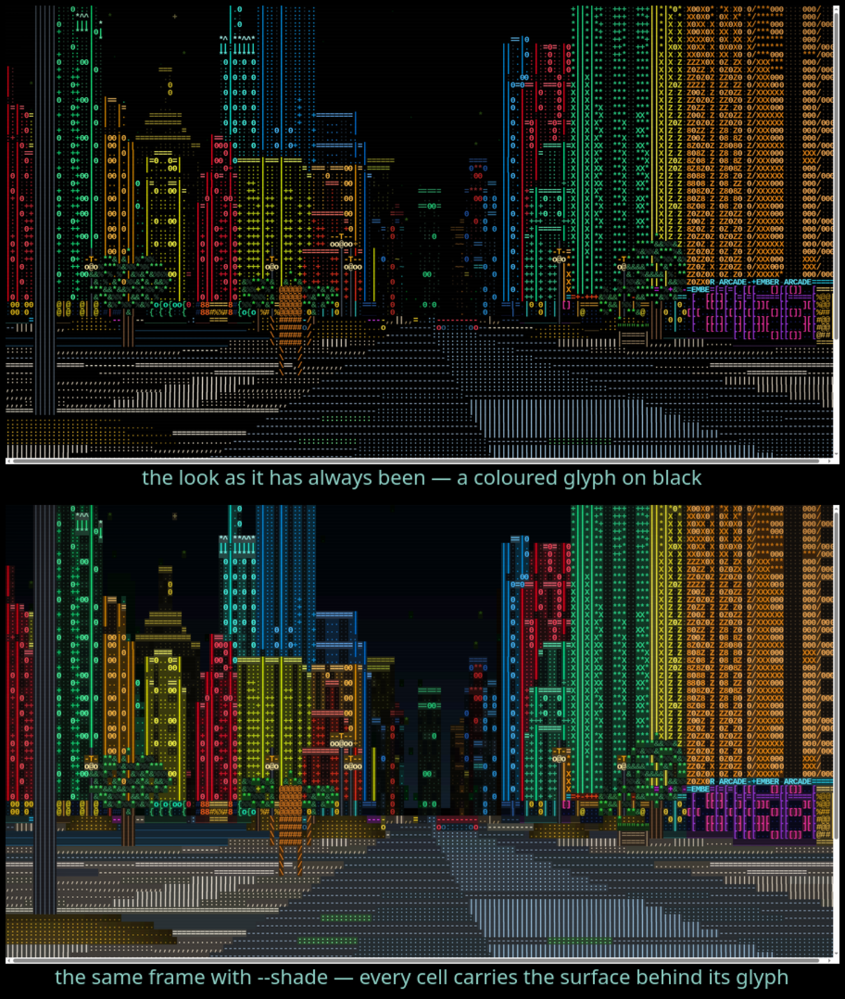

# Shaded cells

`--shade`, or `B` while you are standing there.



## The problem it fixes

An ASCII renderer colours the glyph. Nothing else in the cell gets a colour at
all, because there is nothing else in the cell — a terminal gives you one
character per cell and the rest of the box is whatever the terminal's own
background is, which here is black.

For a dungeon map that is fine. A `#` is a wall, a `.` is a floor, and the
black between them is not pretending to be anything. For a city at night it is
a real loss. A facade is drawn from the wall ramp — `@%#&8ZX*+:. ` — where a
dim surface is a sparse character and a bright one is a dense character. That
ramp is doing two jobs at once: it carries the texture AND it carries the
brightness, because a `.` really does put less light on the screen than a `@`.
What it cannot do is put the surface's colour anywhere the character is not.
So a dim wall is not a dim wall. It is a scattering of dots with black holes
between them, and at a distance a whole tower reads as a lit grid floating in
nothing rather than as a building with mass.

Shading gives the rest of the cell a colour: a dimmed, slightly greyer version
of the colour the glyph itself is drawn in. The glyph stays exactly what it
was. What changes is what is behind it.

The idea is lifted from **Asciikicker**, Goomix's ASCII renderer — the one the
browser game *Asciilands* is built on — which draws every cell with both a
foreground and a background colour and lets a partly-covered glyph read as a
blend of the two.

## What it is NOT

It is not a replacement for the look. `--shade` is off by default, the `B` key
flips it while you walk, and the plain look is the one every frame in `docs/`
was shot with.

It is also not a second renderer. **Shading never changes which character is
drawn anywhere on the frame**: the glyph plane and the foreground colour plane
come out bit-identical with it on and off, and
`shading_only_adds_a_colour_plane` asserts exactly that over a 240-frame walk.
Everything that reads a frame's characters — the registration-plate guarantee,
`--plate-shot`, `--wayfind`, every committed `.txt` evidence frame — says the
same thing in either mode, because it is looking at the same characters.

## How it works

`Grid` has had a background plane since registration plates were black
characters on a painted yellow panel. A plate has been drawn out of ordinary
characters for a while now, so the plane sat unused — present in the ANSI, SVG
and wasm output paths, costing nothing because it was black on every frame.
That is the plane this fills. Nothing new was built to hold it.

Two things write it:

* **`Grid::put`** — the call every drawing pass in the engine already makes.
  With shading on it also writes `ascii_engine::color::shade(colour, glyph)` into the
  background of the cell it just drew.
* **`Grid::put_bg`** — the new one, for the cells a surface pass *skips*. The
  empty end of the wall ramp, the unpainted half of a road marking, the two
  thirds of a distant facade that is deliberately left dark: those are the
  cells that read as holes, and they are the ones shading is for. It writes
  the background and touches nothing else — not the glyph, not the colour
  plane, not the depth buffer — and it will not take a cell that already has a
  character on it, because a blank in this renderer means *see through to
  whatever is behind*, not *an opaque black hole*.

The sky is the third case and gets a whole row at a time: unshaded it is black
with stars on it, which is why the skyline has no edge — black city against
black sky. Shaded it gets the gradient a night sky over a lit city actually
has, and a tower has something to be a silhouette against.

## The two numbers in `color::shade`

```
SHADE_LEVEL_Q      348/1024   how much of a surface's colour survives into the gap
SHADE_INK_BIAS_PCT 45%        how much a DENSE glyph darkens its own background
```

**Why a third and not all of it.** A cell whose gap is as bright as its ink is
a flat block of colour with a letter hidden in it, and the wall ramp — the
thing carrying most of this city's shading — stops meaning anything.

**Why the bias.** A `@` leaves almost no gap to fill, so what little there is
should sit well under the ink. A `.` leaves the whole cell, so its background
is nearly all of what the eye gets and has to carry the surface on its own.
Without that term the ramp compresses from about 10:1 down to about 3:1 and
the city goes flat; with it a solid cell still reads around two and a half
times a near-empty one. `palette::INK` is the table of how much of its box each
character covers, and it is what the bias is applied through.

The result is quantised to multiples of four. A background is a dim colour and
four counts of 255 is invisible there, but it turns a smooth gradient into runs
of equal cells, and the ANSI writer emits one escape sequence per run.

## What it costs

180×60, 400 frames, six interleaved pairs on an otherwise quiet machine
(`--bench` and `--bench --shade` alternating in one run — a figure quoted from
a document is worth nothing, see [What a frame costs](performance.md)):

| | sim | cast | render | paint | total |
|---|---|---|---|---|---|
| plain | 0.014 | 0.141 | 0.371 | 0.126 | 0.652 |
| `--shade` | 0.014 | 0.142 | 0.425 | 0.208 | 0.789 |

**+0.137 ms a frame, +21%** — and more than half of that is `paint`, not the
engine. `paint` is the 24-bit ANSI encode, and a shaded frame has a background
escape sequence to emit wherever the background changes as well as a foreground
one. The `render` half is the extra `put_bg` calls and one table lookup and
three integer multiplies per drawn cell.

The plain path measured **0.652 ms** against **0.655 ms** for the build before
any of this, interleaved into the same run: unchanged, which it has to be — with
shading off not one line of the new code runs, `has_bg` stays false and all
three output writers skip the plane entirely.
