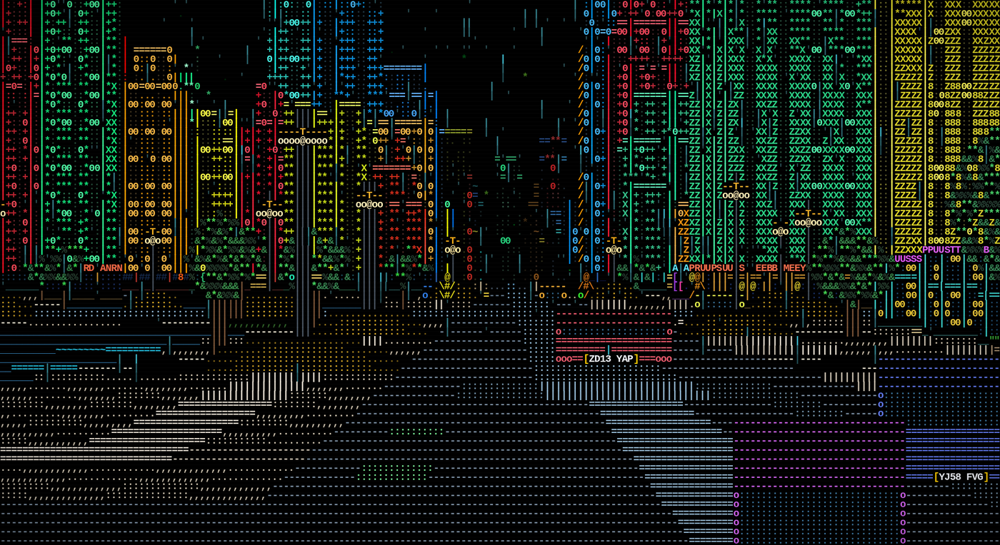
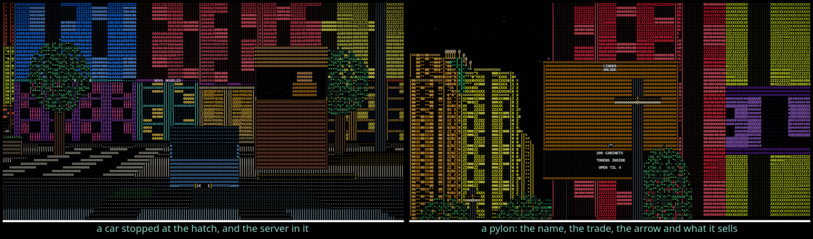
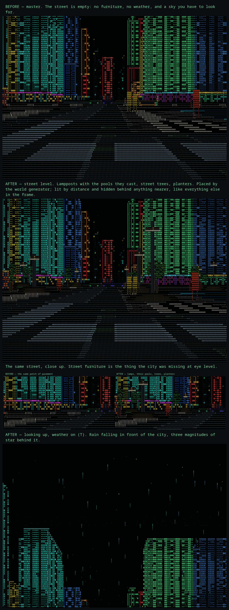

# Weather, and what is on the pavement

## Weather is drawn, not simulated

`T` cycles clear → rain → downpour.

Rain lives in a disc of sky dragged along with you and is drawn through the
same per-column wall buffer the pedestrians go through, so it falls *in front
of* the city and is hidden behind anything nearer, with the same distance
falloff as everything else. It leans with your own velocity — straight down at
a standstill, slanting past you at a run. There is no world-sized array of
drops and nothing off-screen is paid for.

The star field is the same idea in the other direction: three magnitudes off a
lattice hash, computed per frame, never stored. A handful of stars per screen
are drawn bright and near-white, the rest are faint, and the seven rows above
the horizon are a haze band where the city's own light washes the sky out.

Rain is a street-level thing in this engine: drops fall from 12 units and the
vista deck is at 34, so a hold on the skyline comes out dry however wet the
walk was.

## Street furniture

Placed by the world generator (`World::props_near`), not painted on afterwards:
lamps just inside the kerb, trees against the building line, planters on the
forecourt — all pure functions of position like every other feature of this
city.

It is **enumerated, not searched for**. `props_near` walks the four known
cross-offsets of an avenue at a known spacing along it — a few hundred
candidates a frame — instead of scanning the ground for somewhere a lamp could
stand, which would be tens of thousands of `cell()` calls. The cheap rejections
(distance, the leave-a-gap hash) go in front of `cell()`, which is the only
expensive call in that loop.

Props are drawn as billboards through `Renderer::nearest`, the same per-column
wall buffer the population uses, and they are **not** solid: making a lamppost
a `Cell` with height would make it a wall you cannot walk past and would break
the raycaster's assumption that a column is a building. You can walk through a
lamppost. That is a known trade, not an oversight.

A street tree's canopy is **three tones of one green**, and the depth is in the
saturation rather than the hue: the leaves the light catches are vivid and lean
a shade warm, the ones in shadow drop to almost no chroma. The old canopy was
one flat yellow-green at one saturation, which is what made it read as grey
against a facade running full-chroma neon.

Six more kinds were added the same way and for the same reason — a street with
nothing on it but lamps and trees is a corridor, not a place. **Benches** sit
back against the building line, and on a lattice inside the procedural parks;
**phone booths** are lit glass boxes at the lamp offset; **bus stops** stand at
the kerb, a flag on a post with a shelter beside it. All three are generated at
a spacing off the same street walk, so they cost almost nothing.

## A drive-through

The seven-hundredth lamppost is not what makes a street feel lived in; somebody
buying chips at two in the morning is. `Room::FastFood` is one of the fourteen
room families, and where one of them has its entrance on an avenue, the kerb
lane outside it is a **drive-through bay**.

The bay is a pure function of the road (`World::drive_bay`), like everything
else here. That is the whole trick: the markings painted on the tarmac, the
serving hatch on the pavement and the car that stops are three different bits of
code that never speak to each other and cannot disagree, because all three ask
the same function where the bay is. A vehicle whose cell is a bay stops for
`SERVE_TIME`, is served, and drives on — it cannot queue again until it is clear
of the bay. There is no pathing, no state machine, and nothing stored: one `f32`
on the `Actor` (`hold`) says whether a car is standing still and why.

The **serving hatch** is a kiosk at the kerb with a figure in it, sized to the
opening so it is a person at any distance rather than two characters that vanish
at twenty units. It steps toward the bay when there is a car in it, and the
canopy lights — the one thing on the pavement that is not a pure function of
position, and it is read straight off the population rather than stored.

What this deliberately is **not**: the car does not leave the carriageway, turn,
queue behind another car, or wrap round the back of the building. All of that is
pathing, and nothing in this engine has any. See `--drivethru` for the evidence
tool, which waits for a car to pull up of its own accord and exits non-zero if
none ever does.

## Branded pylon signs

A **pylon** is the tall two-post sign a retail park puts at its entrance: a
coloured header with the business's name and trade, an arrow, and a dark panel
of two or three things it sells. Every word on it comes out of the world model —
`palette::building_of` for the name and `interior::ground_room` for the trade,
the *same* two functions the building's own fascia uses, and `Room::offers` for
the three lines, keyed on the trade and nothing else. A pylon cannot advertise a
business that is not behind it, and the arrow points at the actual building.

It is built out of characters and paints nothing, for the registration plate's
reason: everything else on this screen is a coloured glyph on black, and one
filled rectangle reads as pasted on. The **writing** is held over to the end of
the street pass and set all-or-nothing, also for the plate's reason — a
pedestrian who walks in front of `TOKENS INSIDE` after it is drawn leaves
`TOKENS INSID`, which is a different offer, and that is `1 RG` becoming `1 R`
exactly. Too far off, or too narrow on screen to set a line solid, and the board
is a blank board.

Shot with `--drivethru --seed 90210` at 180x60, each `.svg` through headless
Chrome at `1980,1090`, then the label-and-append method in `AGENTS.md`.

`life-and-feel.png` puts the empty street beside the inhabited one: lampposts
and the pools they cast, street trees and planters, and a sky with weather in
front of it and stars behind.

See [Performance](performance.md) for what weather costs.
